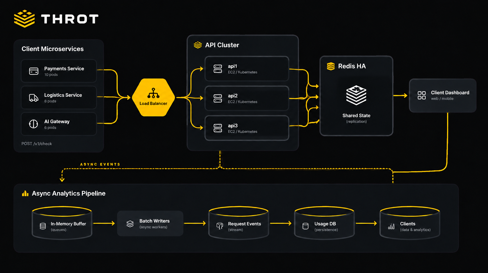

<p align="center">
  
</p>

# THROT

> **Control the Flow. Protect the Core.**

THROT is a high-performance, distributed API rate-limiting engine written in Rust. It enables developers to protect microservices and external-facing APIs from traffic spikes and abusive patterns using Redis-backed atomic rate-limiting algorithms and PostgreSQL for persistent policy management.

---

## Key Features

- **High-Performance Asynchronous Core**: Built on Tokio, Axum, and SQLx.
- **Distributed & Atomic**: Guarantees concurrency safety across multiple THROT nodes via atomic Redis Lua scripts synchronized with Redis server time (`redis.call('TIME')`).
- **5 Proven Rate-Limiting Algorithms**:
  - **Fixed Window Counter**: Window-aligned counters with instant reset.
  - **Sliding Window Log**: Timestamp-level rolling window precision.
  - **Sliding Window Counter**: Memory-efficient weighted previous-window approximation.
  - **Token Bucket**: Burst-capable continuous fractional token refill.
  - **Leaky Bucket (GCRA)**: Constant-rate traffic policing meter.
- **Multi-Tenant Architecture**: Manage Applications, cryptographic API keys (SHA-256 hashed), and scoped rate-limit policies.
- **Fail-Safe Reliability**: Configurable `fail_closed` vs `fail_open` modes per policy during infrastructure outages.
- **Production Observability**: Health (`/health`), readiness (`/ready`), and Prometheus metrics (`/metrics`).

---

## Architecture Overview

<p align="center">
  
</p>

```text
               Client Applications
                       │
                       ▼
                 Load Balancer
                       │
         ┌─────────────┼─────────────┐
         ▼             ▼             ▼
      THROT 1       THROT 2       THROT 3
         │             │             │
         └─────────────┼─────────────┘
                       │
             ┌─────────┴─────────┐
             ▼                   ▼
      Redis Cluster        PostgreSQL
  (Atomic State & TTL) (Metadata & Policies)
```

---

## Workspace Structure

The project is structured as a modular Cargo workspace:

```text
throt/
├── crates/
│   ├── throt-core/         # Domain models (Identity, Policy, Decision, Errors) & RateLimitEngine
│   ├── throt-algorithms/   # 5 rate limiting algorithms, Lua scripts, and Criterion benchmarks
│   ├── throt-storage/      # Redis connection manager & PostgreSQL metadata pool
│   ├── throt-api/          # Axum routes, auth middleware, metrics exporter & envelopes
│   └── throt-server/       # Server entrypoint, configuration validator & graceful shutdown
├── migrations/             # SQLx database schema migrations
├── tests/                  # Concurrency and integration tests
├── docker-compose.yml      # Local development environment (Postgres + Redis + THROT)
└── Dockerfile              # Multi-stage production container build
```

---

## Quickstart

### Prerequisites

- [Rust](https://rustup.rs/) (v1.80+ or latest stable)
- [Docker](https://docs.docker.com/get-docker/) & Docker Compose

### 1. Launch Dependencies

```bash
docker compose up -d throt-postgres throt-redis
```

### 2. Configure Environment

Copy the example configuration:

```bash
cp .env.example .env
```

### 3. Run THROT

```bash
cargo run -p throt-server
```

The service will bind to `http://localhost:8080`.

---

## API Reference

All requests to `/v1/*` (except app creation) require authentication via `X-API-Key: <key>` or `Authorization: Bearer <key>`.

### 1. Register Application

```bash
curl -X POST http://localhost:8080/v1/apps \
  -H "Content-Type: application/json" \
  -d '{"name": "Billing Service"}'
```

Response (contains plaintext API key, displayed only once):
```json
{
  "success": true,
  "data": {
    "application": {
      "id": "1e14ff2b-cf0c-4028-a40d-c0ce93309e4f",
      "name": "Billing Service",
      "status": "active",
      "created_at": "2026-11-01T23:50:00Z",
      "updated_at": "2026-11-01T23:50:00Z"
    },
    "api_key": {
      "id": "c1f7a28e-5b1b-417d-94ea-2d7c71629864",
      "application_id": "1e14ff2b-cf0c-4028-a40d-c0ce93309e4f",
      "raw_key": "throt_live_9d4f29a038c...",
      "key_prefix": "throt_live_9d4f",
      "created_at": "2026-11-01T23:50:00Z"
    }
  }
}
```

### 2. Create Rate Limit Policy

```bash
curl -X POST http://localhost:8080/v1/policies \
  -H "Content-Type: application/json" \
  -H "X-API-Key: throt_live_9d4f29a038c..." \
  -d '{
    "name": "standard-api",
    "algorithm": "token_bucket",
    "request_limit": 100,
    "window_seconds": 60,
    "burst_capacity": 120,
    "refill_rate": 2.0,
    "failure_mode": "fail_closed"
  }'
```

### 3. Evaluate Rate Limit Decision

```bash
curl -X POST http://localhost:8080/v1/limits/evaluate \
  -H "Content-Type: application/json" \
  -H "X-API-Key: throt_live_9d4f29a038c..." \
  -d '{
    "identity": "user:12345",
    "policy": "standard-api",
    "cost": 1
  }'
```

Allowed Response (`200 OK`):
```json
{
  "allowed": true,
  "limit": 120,
  "remaining": 119,
  "reset_at": 1790000060
}
```

Rejected Response (`200 OK`):
```json
{
  "allowed": false,
  "limit": 120,
  "remaining": 0,
  "reset_at": 1790000060,
  "retry_after": 15
}
```

---

## Health & Observability Endpoints

- **Liveness Probe**:
  ```bash
  curl http://localhost:8080/health
  # {"status":"pass","timestamp":1790000000}
  ```

- **Readiness Probe**:
  ```bash
  curl http://localhost:8080/ready
  # {"ready":true,"redis":"ok","postgres":"ok","timestamp":1790000000}
  ```

- **Prometheus Metrics**:
  ```bash
  curl http://localhost:8080/metrics
  # throt_evaluations_total{algorithm="TokenBucket",allowed="true"} 42
  # throt_evaluations_fallback_total{mode="FailClosed"} 0
  ```

---

## Running Tests & Benchmarks

### Test Suite

Run unit, integration, and Redis concurrency tests:

```bash
cargo test --workspace
```

### Benchmarks

Run Criterion algorithm microbenchmarks:

```bash
cargo bench -p throt-algorithms
```

---

## License

Licensed under either of [MIT](LICENSE-MIT) or [Apache-2.0](LICENSE-APACHE) at your option.
